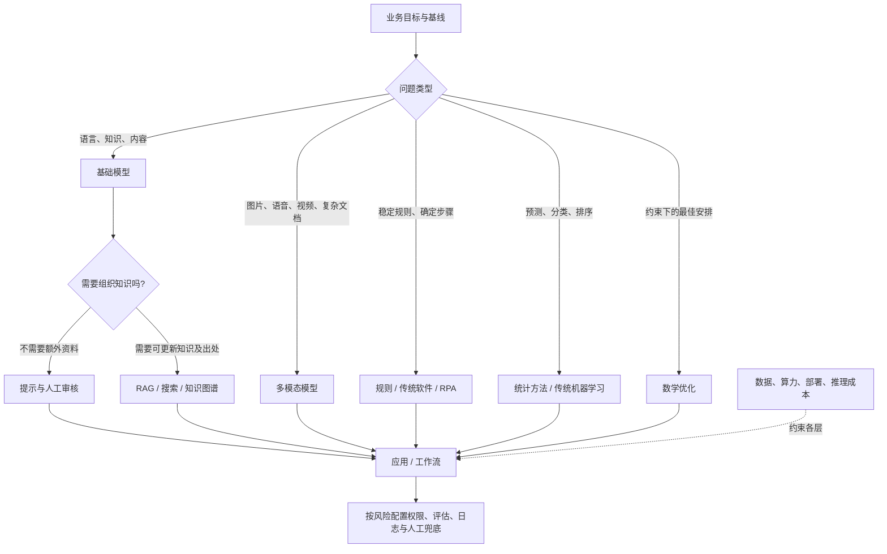

# AI 技术全景图：从业务问题到技术选择

## 先看决策地图

技术选型从业务问题和约束出发，而不是从模型名称出发。先确认目标、现行流程、基线、失败代价、数据权限和预算，再选最简单且可验证的方案。流程稳定、规则明确时，规则或传统软件可能优于 AI；目标是预测或排程时，统计模型或数学优化通常比生成式模型合适。

## 六层关系：每层决定什么

| 层次 | 决定的问题 | 管理者应关注 |
|---|---|---|
| 1. 基础设施与部署 | 在哪里运行、由谁运维 | 数据分类、网络与合规要求、可用资源、采购与退出安排；公有云、私有化或混合方案均需核验具体服务和合同 |
| 2. 数据与知识 | 系统可以依据什么 | 数据权属、质量、更新、访问权限、留存和删除；数据平台有价值，但不是每个试点的前置大工程 |
| 3. 模型与方法 | 用什么方法处理问题 | 预测/分类用统计或机器学习；约束排程用优化；语言生成用基础模型；不同方法可组合 |
| 4. 适配与检索 | 如何让模型遵循任务、使用组织资料 | 提示、检索增强生成（RAG）、微调、知识图谱各解决不同问题，不能互相替代所有能力 |
| 5. 应用与流程 | 谁在何处使用，系统能执行什么 | 用户体验、与现有系统集成、人工确认点、权限边界；RPA 与智能体可组合 |
| 6. 治理、评估与运营 | 如何证明适用并控制风险 | 上线前基线与测试、上线后监控和复核、审计记录、事件处置、供应商与模型变更管理 |

这些层不是采购清单，也不要求每个项目都自建一套。组织可以采购某些层的服务，但仍需明确责任边界、数据处理约定和退出方案。

## 代表技术与选择规则

以下情景仅为假设示意，不代表项目成果或真实案例；是否适用须用本组织数据验证。

### 1. 传统预测与机器学习

**一句话本质：** 从历史样本中学习规律，对新样本的类别、数值或风险作估计；其本质是从数据中归纳可检验的映射。

**现实价值：** 适合需求预测、故障预警、风险排序、质量分类等有重复数据和明确目标的任务。可用留出数据评估误差、召回率或校准情况，不能仅凭模型演示推断经营收益。

**相近方案与选择：** 若关系简单、数据少或规则可解释要求高，先用统计基线或业务规则；需要把大量结构化特征映射到预测结果时，再比较传统机器学习与简单基线。数据分布变化、标签偏差或错误代价不对称会限制效果，必须持续监测并保留人工处理路径。

参考：随机森林是一类预测方法 [S001]，不代表传统机器学习的全部。

### 2. 数学优化

**一句话本质：** 把目标和资源限制写成可计算的规则，在可行方案中寻找较优安排；本质是有约束地分配稀缺资源。

**现实价值：** 排班、车辆路径、生产计划、预算分配等问题，目标和约束可以明确描述时，优化方法可帮助比较方案并解释资源取舍。

**相近方案与选择：** 约束清楚且需要可行排程时，优先评估运筹优化；约束难以完整表达、主要依赖经验判断时，可先用规则或人工决策。真实问题可能规模过大、数据不准或目标冲突，求解结果不自动等于可执行方案，需业务人员校验。可将机器学习预测的需求作为优化输入。

参考：组合优化工具及问题类型 [S002]。

### 3. 基础模型（大语言模型）

**一句话本质：** 常见生成式大语言模型在大量数据上训练，并依据上下文预测和生成内容，从而支持多种语言任务，但并不天然具备事实核验能力。

**现实价值：** 可用于起草、摘要、问答、分类和信息抽取等语言工作，适合任务变化多、规则难以逐条编写的环节；输出应通过抽样评估和必要的人工审核。

**相近方案与选择：** 固定格式、稳定规则任务优先传统程序；专用、低复杂度任务可评估小模型或采购软件；开放式语言任务可试用通用模型，再比较领域模型。模型能力、价格、许可、数据处理条款和服务稳定性因供应商及版本而异。开源权重不等于免许可、可商用或无运维成本。

参考：大语言模型的上下文学习研究 [S003]。论文描述特定模型和实验，不代表其他模型或组织任务的效果。

### 4. 提示工程

**一句话本质：** 用指令、上下文和输出格式约束模型完成任务；本质是调整输入来引导已有模型能力。

**现实价值：** 对任务边界清楚、无需频繁查内部资料的摘要、改写、分类等任务，可快速验证可行性，迭代成本通常低于训练模型。

**相近方案与选择：** 先用提示建立基线；需要引用不断更新的组织资料时加检索；提示无法稳定改变固定行为且有合规数据、评测集和训练资源时，再评估微调。提示不能保证事实正确、权限隔离或行为一致，需测试边界输入并管理版本。

参考：上下文示例引导模型的研究 [S003]；实际提示方案仍须针对任务评估。

### 5. 检索增强生成（RAG）与知识图谱

**一句话本质：** RAG 先检索相关资料，再把资料交给模型组织回答；本质是让回答过程能够引用外部知识，而不是把知识永久写进模型参数。

**现实价值：** 适用于制度、产品手册、政策等需要更新或标注出处的内部问答。可测检索是否找到正确材料、回答是否忠于材料及引用是否可追溯。

**相近方案与选择：** 短期、无需组织知识的任务用提示即可；知识频繁变更且需要来源时优先评估搜索/RAG；实体关系复杂、需要沿明确关系查询时，可用知识图谱，必要时与 RAG 组合。RAG 不保证检索完整或回答正确；文档权限、版本、切分和检索质量均影响结果，敏感资料的访问控制必须在检索层落实。

参考：RAG 原论文 [S004]。

### 6. 微调

**一句话本质：** 用精选示例继续训练已有模型，使其更稳定地呈现特定任务行为或表达方式；本质是调整模型参数，而非自动补入实时知识。

**现实价值：** 当任务格式、分类口径或行业表达长期稳定，且提示难以达到所需一致性时，可评估微调，并以独立测试集比较前后表现。

**相近方案与选择：** 资料会更新、答案需有出处时优先检索；行为或格式需要稳定且有足够高质量样本时再试微调；两者也可组合。微调需要数据治理、训练和回归评估，可能强化偏差或损害原有能力，并不保证提高准确性。

参考：以人类反馈调整模型行为的研究 [S011]。

### 7. 多模态模型

**一句话本质：** 接收或生成文字以外的图像、语音、视频等内容；本质是让模型处理不同形式的输入输出。

**现实价值：** 可用于文档版面理解、语音转写、图像初筛或质检辅助，减少人工逐项录入的负担；上线决策应看本组织材料上的错误类型、复核成本和失败后果。

**相近方案与选择：** 对可直接读取的文本先比较规则抽取；扫描件可比较光学字符识别（OCR）与文档理解方案；语音转文字可比较专用语音识别；复杂图片理解再评估多模态模型。遮挡、低质影像、专业细节和环境差异会带来错误；高风险判断应由专业人员复核，不能把模型输出当作测量或诊断结论。

参考：视觉语言模型研究 [S008]，不能代表所有多模态系统。

### 8. RPA 与智能体

**一句话本质：** 机器人流程自动化（RPA）按预设步骤操作软件，智能体（Agent）则由模型根据目标选择下一步工具；本质分别是脚本执行和不确定条件下的动态决策。

**现实价值：** 固定、重复、界面稳定的跨系统录入适合先评估 RPA；需处理多样语言信息或例外情况的工作，可让模型辅助分类或拟定操作，再由人确认。

**相近方案与选择：** 步骤稳定且结果可预期时优先规则、API 或 RPA；开放任务可先采用只读智能体或建议模式，验证后再逐步授权。智能体可能误判、重复操作或调用错误工具；涉及付款、审批、个人信息或不可逆操作时，应设置最小权限、确认点、限额和审计。两者可组合，AI 负责理解、RPA 负责确定步骤。

参考：RPA 供应商的定义 [S012] 与 ReAct 论文 [S007]；后者不构成生产环境可自治的证明。

### 9. 部署方式

**一句话本质：** 部署方式决定模型在哪个环境运行、谁管理底层设施和数据处理；本质是控制、成本、运维责任和服务弹性的取舍。

**现实价值：** 公有云 API 可减少自建运维并便于试用；私有化可增加环境控制但需要硬件、人员和升级维护；混合部署可按数据和任务分类安排，但集成更复杂。

**相近方案与选择：** 对每个候选服务核对数据流、日志、留存、训练用途、区域、分包商、合同、退出与故障安排。不得假设“私有化”自动合规，也不能笼统声称云端必然出域或绝不出域；以具体架构、合同和适用法规核验。没有可核验的数据分类和威胁模型前，不宜仅凭部署标签作决定。

### 10. 推理优化

**一句话本质：** 通过选择模型、压缩、缓存或减少重复计算来调整运行成本与响应特性；本质是在任务质量、资源消耗和响应之间权衡。

**现实价值：** 用量增长后，可比较不同模型或量化方案的单位任务成本、时延、错误率和运维负担，决定是否优化；先测基线，再用代表性任务回归评估。

**相近方案与选择：** 先检查不必要调用、提示长度和缓存命中，再评估更小模型、批处理或量化；当质量下降或维护复杂度超过节省时，不应优化。蒸馏、量化或缓存都不保证成本或延迟必然下降，结果取决于硬件、负载和任务。

参考：特定量化方法的研究 [S009]，实验结果不可直接外推。

## 组合示意与组织差异

假设某组织希望缩短政策咨询处理流程：先用规则识别可直接答复的常见问题；对需要查现行制度的问题，用带权限控制的检索提供材料，再由基础模型拟稿并展示引用；复杂或高风险问题转人工。此示意只描述一种待验证的设计，不代表它必然节省时间或成本。

企业可把收入、成本、风险和客户体验作为目标；政府机关还需关注服务公平、政务数据规则、采购与信创要求；事业单位需兼顾公益目标和专业审核；非营利组织应考虑有限预算、人员维护能力及资金使用透明度。各组织都应先明确目标与基线，再决定是否引入 AI。

## PPT 要点

- 先识别问题类型，再选方法：规则、预测、优化、生成各有适用边界。
- 六层视图区分基础设施、数据、模型、适配、应用和治理责任。
- 提示、RAG、微调解决不同问题，可组合但不能互相保证正确性。
- 公有云、私有化、混合部署都要按具体数据流、合同和运维能力评估。
- 先建立基线，用本组织任务验证；AI 不是默认答案。
